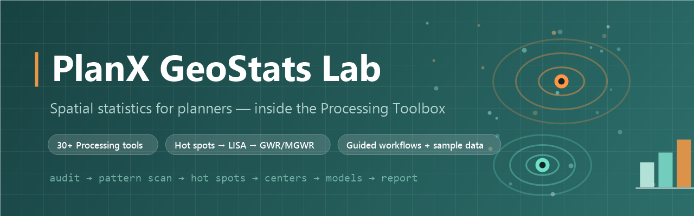

<div align="center">



# GeoStats Lab

**Hot spots, clusters and outliers, spatial autocorrelation, regions, regression and interpolation, inside the QGIS Processing Toolbox.**

[](https://github.com/YusufEminoglu/planx_geostats/releases)
[](LICENSE)
[](https://geophilo.com/planx_geostats/manual.html)
[](https://qgis.org)
[](https://plugins.qgis.org/plugins/planx_geostats/)
[](https://github.com/YusufEminoglu/PlanX)

From *"is this clustered?"* to *"which model explains it?"*:
**102 Processing algorithms in eight groups, each with documented output fields and, for most, a plain-language HTML report.**

[Install](#-installation) · [Tool catalog](#-tool-catalog) · [Reading the results](#-reading-the-results) · [Guided workflow](#-a-lab-not-a-toolbox-dump) · [Optional libraries](#-optional-libraries) · [Sample data](#-bundled-sample-data)

</div>

---

## 📖 Documentation

The **[reference manual](https://geophilo.com/planx_geostats/manual.html)** documents all 102 algorithms in eight groups: the method, its formulas, every parameter and output field, how to read the result, and the literature. Each tool's Help button in the Processing dialog opens its own section of the manual. Bugs and requests go to [GitHub issues](https://github.com/YusufEminoglu/planx_geostats/issues).

---

## ✨ Why GeoStats Lab?

| | |
|---|---|
| 🧭 **It guides, not just computes** | A **Workflow Advisor** recommends a tool sequence for your analysis goal; a **Data Readiness Audit** checks geometry validity, CRS risk, outliers and multicollinearity *before* you model. Every report explains assumptions, pitfalls and safer moves. |
| 📊 **Full method ladder** | Global pattern scans → local hot spots/outliers → centers & direction → OLS/GLR → spatial lag & error models → GWR/**MGWR** → model comparison → Monte Carlo sensitivity. One provider, one consistent reporting style. |
| 🧪 **Reproducible & honest** | Permutation inference where it matters, CSV/JSON exports for audit handoffs, and HTML analyst guidance attached to results — interpretation included, not implied. |
| 🏙 **Planner-first** | Bundled **İzmir Functional Urban Region (FUR)** dataset (391 polygons, street-network and space-syntax accessibility indicators) so every tool is try-able in one click. |
| 🔌 **Honest dependencies** | Core tools run on pure QGIS. Advanced methods (PySAL/MGWR/scikit-learn) are optional — a **Library Status** tool diagnoses the QGIS Python environment and a transparent installer previews the exact pip command before touching anything. |

---

## 🛠 Tool Catalog

All tools live under **Processing Toolbox → PlanX GeoStats Lab**, organised as a numbered workflow:

### `00` Setup & Diagnostics
GeoStats Library Status · Install/Update GeoStats Libraries · Sample Dataset Guide · **GeoStats Workflow Advisor** · **Data Readiness Audit**

### `01` Data Preparation & Neighborhoods
Export Attributes · **Rate Smoothing (Empirical Bayes)** · Spatial Weights Workbench and Distance Band (visual node/edge graph, connectivity/islands, repair, higher order, distance decay, CSV exchange)

### `02` Urban Pattern Scan *(global statistics)*
| Tool | Question it answers |
|---|---|
| Average Nearest Neighbor | Are my points clustered or dispersed? |
| Ripley's K | …and at which distances? |
| Global Moran's I | Is the attribute spatially autocorrelated? |
| Geary's C | …and how sensitive is that to sharp local contrast rather than the global mean? |
| Incremental Spatial Autocorrelation | At what scale does clustering peak? |
| Getis-Ord General G | Do high or low values dominate the clustering? |
| Bivariate Lee's L | Do two indicators co-cluster in space? (genuine Lee's L since 3.11 - both fields smoothed) |
| **Gamma Index** | Is the pattern robust to how attribute similarity is defined (cross-product, squared or absolute difference)? |
| **S-maup** | If I aggregate these areas into k zones, will the result depend on how the zones are drawn? |
| **Spatial Inequality (Gini + Spatial Gini)** | How unequal is the distribution — and how much of that inequality is *spatial*? |
| Join Count Statistics | Does a categorical/binary field cluster or checkerboard? |
| Geodetector Q-Statistic | Does a categorical partition explain variance in an outcome? |

### `03` Hot Spots, Spatial Outliers & Regions *(local statistics and regionalization)*
| Tool | Output |
|---|---|
| Hot Spot Analysis (Getis-Ord Gi\*) | FDR/Bonferroni-controlled hot/cold spots plus a stability consensus over neighbouring definitions of the chosen weights (up to five runs) |
| Cluster & Outlier Analysis (Local Moran's I / LISA) | FDR/Bonferroni-controlled HH·LL clusters and HL·LH outliers |
| Bivariate LISA | Where high values of one field sit next to high (or low) values of another |
| Local Geary's C | Multiple-testing-controlled local contrast and outlier detection |
| Colocation Quotient | Does one point category attract or avoid another (asymmetric)? |
| Multivariate Clustering | K-means feature groups across several indicators, with a cluster-quality report |
| **SKATER Regionalization** | K spatially *contiguous* regions, not just attribute-similar groups (now with a partition-quality report) |
| **Max-p Regions** | As many contiguous zones as possible, each meeting a minimum population/area - the number of regions is an output |
| **AZP Regionalization** | Exactly k contiguous zones by Openshaw's Automatic Zoning Procedure (basic, simulated annealing, tabu) |
| **REDCAP Regionalization** | Deterministic contiguity-constrained hierarchical zoning (Guo 2008, full-order linkage) |
| **Regionalization Quality Assessment** | R², attribute/boundary/path silhouettes, compactness, contiguity and agreement with a reference zoning for *any* partition |
| **Rate Cluster & Outlier Analysis (EB Local Moran)** | LISA on rates without small-population artefacts, with a raw-vs-EB cross-table |
| **Multivariate Local Geary** | Units similar to (or standing out from) their neighbours across several fields at once |
| **Local Join Counts** | Where presence/absence data cluster, co-locate or sit side by side |
| **LOSH** | How *variable* each neighbourhood is - uniform vs heterogeneous hot spots |
| **Partial / Conditional Local Moran** | Which clusters survive once known covariates are accounted for? |
| Bivariate Lee's L (local) | Where two fields co-cluster, now with a permutation test |
| Similarity Search | Features most similar to your reference feature |

### `04` Centers, Direction & Dispersion
Mean Center · Median Center · Central Feature · Standard Distance · Standard Deviational Ellipse · Linear Directional Mean

### `05` Models & Scenarios
| Tool | Method |
|---|---|
| Ordinary Least Squares | Baseline regression + residual diagnostics |
| **Lagrange Multiplier Diagnostics** | Formal SAR-vs-SEM specification test |
| Generalized Linear Regression | Gaussian/binary/count families |
| Exploratory Regression | Search candidate variable combinations |
| Spatial Lag Regression | Spatial dependence in the outcome |
| Spatial Error Regression | Spatial dependence in the residuals |
| Spatial Durbin Model | Lags outcome and predictors; reports direct, spillover and total impacts |
| GWR / **MGWR** | Local and multiscale relationships; GWR supports automatic AICc/CV bandwidth selection |
| Eigenvector Spatial Filtering | Spatial control without estimating an autoregressive parameter |
| **Spatial Regime Regression** | Separate coefficients per district/category, with a Chow test |
| **Quantile Regression** | Model a chosen quantile (e.g. the upper tail), not just the mean |
| **Geographically Weighted Summary Statistics** | Local mean/std/skew of a field, GWR-kernel style |
| Model Comparison | Score competing models side by side |
| Monte Carlo Sensitivity Test | How robust is the result to perturbation? |

### `06` Machine Learning & Explainable AI
| Tool | Question it answers |
|---|---|
| Random Forest / Extra Trees / SVM / Neural Network (Regression & Classification) | Predict a continuous or categorical outcome |
| Gradient Boosting (scikit-learn / XGBoost / LightGBM / CatBoost, Regression & Classification) | The strongest tabular predictor, four interchangeable engines |
| TabPFN Regression / Classification | A 2025 zero-shot tabular foundation model — no training loop, no tuning |
| Spatial k-Fold Cross-Validation Evaluator | An honest, spatially-blocked out-of-sample score (K-Means block or kNNDM fold matching) |
| Permutation Feature Importance · Partial Dependence Report | Model-agnostic importance and direction of effect |
| ML Model Comparison (Leaderboard) | Rank every model family on the same, spatially cross-validated basis |
| **SHAP Global / Spatial Attribution Map / Local Explanation** | Which field matters, **where** it matters (mapped), and why for one record |
| Explainable Boosting Machine (Regression & Classification) | A glass-box model whose per-field contributions are exact, not sampled |
| DiCE Counterfactual Explanation | What minimal change to one record would flip its predicted class |
| Model Residual Spatial Autocorrelation Check | Has the ML model left real spatial structure unexplained? |
| Prediction Uncertainty Map | Where is a Random Forest/Extra Trees prediction least trustworthy? Reuse an audited session model without refitting. |
| Conformal Prediction Interval | A distribution-free, coverage-guaranteed prediction interval for any regression model |
| DBSCAN · HDBSCAN · Gaussian Mixture | Density-based and probabilistic clustering alternatives to K-Means |

### `07` Interpolation & Geostatistics
| Tool | Question it answers |
|---|---|
| Empirical Semivariogram & Model Fitting | How fast does similarity decay with distance here, and what nugget, sill and range describe it? |
| Ordinary / Universal Kriging Interpolation | What does the surface look like between the observations — and how uncertain is each cell? |
| Inverse Distance Weighted Interpolation (IDW) | A model-free surface from a distance-weighted average — and how does its power affect it? |
| Radial Basis Function Interpolation (RBF) | The smoothest surface through the observations, from four interchangeable kernels |
| Natural Neighbour Interpolation (Sibson) | A smooth exact surface with linear precision that adapts to uneven sampling — and is undefined outside the observation hull |
| Polynomial Trend Surface Interpolation | Which way does this field go, and what is left once the regional trend is removed? |
| Empirical Bayesian Kriging Interpolation | The same question as kriging, when the variogram is not known in advance and the uncertainty reported has to account for fitting it |
| Indicator Kriging (Threshold Exceedance Probability) | How likely is this location to be above this level — answered once per level, without assuming a distribution for the field |
| Interpolation Model Comparison | Which interpolator should I use on this field, and is the winner's margin larger than the noise of this sample? |

---

## 🔎 Reading the results

- **Use a projected CRS for distance bands.** A distance band is measured in the layer's CRS units. On a geographic CRS such as EPSG:4326 that unit is degrees, so the tools refuse a distance band there and ask you to reproject the layer to a metric CRS first.
- **Points need distance-based neighbours.** Queen and rook contiguity only work for polygons that share edges or corners; on points no feature would have a neighbour. Use K nearest neighbours or a distance band.
- **Missing values are left out, not guessed.** Features with a NULL (or NaN) value in an analysed field are skipped, the spatial weights are rebuilt on the features that remain (row-standardised weights are standardised again), and the report says how many were skipped. In the hot spot and cluster maps (Gi\*, Local Moran's I, Local Geary's C, Bivariate LISA, LOSH) these features get the class "No data".
- **Islands have no local result.** A feature with no neighbours under the weights you chose (an island) cannot be compared with its surroundings, so the local statistics give it no value and no p-value and map it as "No neighbours" (Gi\* also writes `gi_conf` 0). If many features are islands, widen the distance band or raise K. A run in which no feature has a neighbour, every value is missing or the field has no variance stops with a message.
- **Multiple testing.** A local statistic runs one test per feature, so with 1,000 features about 50 would pass p < 0.05 by chance alone. The false discovery rate (FDR, Benjamini-Hochberg) option keeps the expected share of false finds among the features called significant at the chosen level; Bonferroni is stricter and controls the chance of even one false find. The class on the map is based on the corrected p-value, and the report names the correction in words (for example "Benjamini-Hochberg false discovery rate").
- **Permutation p-values have a floor.** With 999 permutations the smallest possible pseudo p-value is 0.001; use more permutations when you correct for many tests.

---

## 🧭 A lab, not a toolbox dump

The intended session is itself a method:

```text
00 Data Readiness Audit  →  02 pattern scan      →  03 hot spots / LISA
        ↓                        (is it clustered?)       (where exactly?)
   Workflow Advisor                                            ↓
   (pick the goal,        05 OLS → spatial lag/error → GWR/MGWR → comparison → sensitivity
    get the sequence)        (why? and is the "why" stable across space and noise?)
```

Each report ends with **interpretation guidance** — what the statistic assumes, what commonly goes wrong, and which tool to run next. The decision logic lives in QGIS-independent core helpers, so it is unit-tested headlessly on every release.

---

## 🔌 Optional Libraries

Core tools are pure QGIS. Advanced methods use, when present:

`libpysal` · `esda` · `spreg` · `mgwr` · `scikit-learn` · `numba` · `xgboost` · `lightgbm` · `catboost` · `shap` · `interpret` · `mapie` · `dice-ml` · `tabpfn`

> **The honest installer:** QGIS plugins run inside QGIS's own Python — installing into Anaconda or a system Python won't help. *GeoStats Library Status* shows exactly which interpreter QGIS uses and what's missing; *Install/Update GeoStats Libraries* previews the full pip command and only runs it after an explicit confirmation checkbox. Restart QGIS afterwards.

---

## 🗂 Bundled Sample Data

| Dataset | Contents | Use it for |
|---|---|---|
| **İzmir FUR street network** (`planx_geostats_izmir_fur.gpkg`) | 391 polygons; road density, intersections, block/lane geometry, reach and transit accessibility, space-syntax and network-topology indicators — all-numeric schema | Realistic end-to-end workflow practice |
| **Synthetic QA fixture** (`planx_geostats_synthetic_qa.gpkg`) | Deterministic point/line/polygon + model-output layers | Edge cases: KNN weights, multipart lines, binary/count models |
| **Classification QA fixture** (`planx_geostats_classification_qa.gpkg`) *(v2.0.0)* | 120 points, numeric fields + `density_class` category | ML classification tools, Spatial Regime Regression |

Load any combination via `00 → Sample Dataset Guide`, then run `Data Readiness Audit` for suggested analysis roles and starter sequences.

---

## 📦 Installation

**From QGIS Plugin Hub** *(recommended)*
> `Plugins → Manage and Install Plugins…` → search **GeoStats Lab** → Install. Tools appear in the **Processing Toolbox**, and a dockable **GeoStats Lab panel** — opened via its toolbar icon or the Plugins menu — groups all 102 tools by category with search and one-click launch.

**From ZIP**
> Download the latest zip from [Releases](https://github.com/YusufEminoglu/planx_geostats/releases) → `Plugins → Install from ZIP`.

| Requirement | Value |
|---|---|
| QGIS | **3.28 LTR → 4.x** (validated on both runtimes) |
| Hard dependencies | None — pure QGIS for core tools |
| Optional | PySAL stack + scikit-learn via the built-in guided installer |
| License | [GPL-3.0-or-later](LICENSE) |

---

## 🧪 Quality

- **Headless smoke tests** (`tests/smoke_core.py`, `smoke_sample_data.py`, `smoke_provider_catalog.py`) run without QGIS and gate every release. The report decision logic is intentionally kept in **QGIS-independent core helpers**, so **workflow advising**, **model-comparison scoring**, **Monte Carlo sensitivity interpretation**, **Global Moran's I report interpretation** and **Spatial Gini inequality decomposition** are unit-tested without launching QGIS.
- A **full QGIS runtime matrix** executes every algorithm against the bundled sample data on **QGIS 3 LTR and QGIS 4**.
- An **esda parity suite** (`tests/esda_parity.py`) checks every rate-smoothing and extended-LISA statistic, and Global Moran's I, General G, Geary's C, Gi\*, Gi, local Moran's I with its quadrants, OLS p-values and the rook and queen neighbour sets, against PySAL's esda and libpysal on the same data and weights - they agree to floating-point precision - while the shipped engines themselves need nothing beyond numpy. `tests/smoke_local_stats.py` pins their mathematical properties (Lee's L symmetry, closed-form chi-square tails, a hand-computed multivariate Geary value, exact join counts) without QGIS.
- `tests/test_numeric_truth.py` checks Global Moran's I, General G, Geary's C, Gi\*, local Moran's I and OLS against independent dense-matrix formulas and exact permutation distributions. `tests/test_robustness_qgis.py` runs islands, missing values, points with contiguity weights, a geographic CRS, cancelling and attribute preservation through the real algorithms, and `tests/test_dock_qgis.py` checks dock contrast, double-click defaults and search.
- `tests/smoke_regionalization.py` checks that max-p, AZP and REDCAP recover a known four-block partition, never break contiguity, the max-p floor or the minimum size, and that the quality measures hit closed-form values; the esda parity suite also checks the silhouettes and V-measure against esda and scikit-learn.
- The reference manual is **built, not hand-edited**: `py -3 tools/build_manual.py` renders the cards kept in `tools/manual_src/`, derives the version, the algorithm count and the per-group tool counts from the plugin itself, and writes the docs/ and root copies byte-identically; `--check` fails when they are stale.
- A manual **QA test matrix** (`QA_MANUAL_TEST_MATRIX.md`) covers setup, statistics, symbology, report interpretation and release gates.
- The release-zip verifier asserts that **developer-only paths are absent**, **algorithm icons are present**, and metadata points to a packaged icon. GeoStats Lab is packaged as a **hybrid Processing + dock-GUI plugin**, so its menu/toolbar hooks (the GeoStats Lab dock panel) are an intentional, verified part of the release rather than a packaging mistake.

<details>
<summary><b>Developer validation commands</b></summary>

```powershell
py -3 planx_geostats\tests\smoke_core.py
py -3 planx_geostats\tests\smoke_sample_data.py
py -3 planx_geostats\tests\smoke_provider_catalog.py
py -3 planx_geostats\tests\smoke_local_stats.py
py -3 planx_geostats\tools\build_manual.py --check
py -3 packaging\test_verify_release_zip.py
py -3 packaging\validate_plugin.py planx_geostats --strict
powershell -NoProfile -ExecutionPolicy Bypass -File .\packaging\Build-PluginZip.ps1 -PluginDir planx_geostats
py -3 packaging\verify_release_zip.py QGIS_Plugin_Releases\planx_geostats.zip --root planx_geostats --version 3.13.1
```

</details>

---

## 🧩 Part of the PlanX ecosystem

This plugin belongs to an open-source QGIS ecosystem for urban planning by the same author:

| Planning & analysis | CAD & production | 3D & visualization |
|---|---|---|
| [PlanX](https://github.com/YusufEminoglu/PlanX) — urban analytics studio | [CAD Drafting Toolset](https://github.com/YusufEminoglu/PlanX-CAD) — drafting, measurement, road platforms | [3D City Studio](https://github.com/YusufEminoglu/planx_3d_city) — QGIS to Three.js city viewer |
| [GeoStats Lab](https://github.com/YusufEminoglu/planx_geostats) — spatial statistics | [EasyFillet](https://github.com/YusufEminoglu/EasyFillet) — tangent-arc fillet | [3D OSM Model](https://github.com/YusufEminoglu/osm_3d_model) — OSM to a 3D city in the browser |
| [MCDA Suitability Lab](https://github.com/YusufEminoglu/planx_suitability_lab) — raster MCDA | [Settlement Planning Toolset](https://github.com/YusufEminoglu/PlanX-Settlement) — block-to-parcel settlement plans | [OSM Quick 3D](https://github.com/YusufEminoglu/osm_quick_3d) — OSM to native QGIS 3D |
| [DataCube Lab](https://github.com/YusufEminoglu/planx_datacube) — space-time data cubes | [UIP Zoning Plan Toolset](https://github.com/YusufEminoglu/PlanX-UIP) — Turkish implementation plans | [Urban Procedural 3D Studio](https://github.com/YusufEminoglu/planx_urban_procedural_3d) — parametric zoning lab |
| [Urban Resilience Lab](https://github.com/YusufEminoglu/planx_urban_resilience) — seismic, flood, heat and social vulnerability | [ParcelFlux](https://github.com/YusufEminoglu/parcelflux) — parcel subdivision | [02CartoLab](https://github.com/YusufEminoglu/zero2cartolab) — thematic maps and print layouts |

---

## 🤝 Contributing & Support

- 🐛 **Bugs / requests** → [GitHub issues](https://github.com/YusufEminoglu/planx_geostats/issues)
- 📜 **Changelog** → [CHANGELOG.md](CHANGELOG.md) follows *Keep a Changelog*
- ✅ Before a PR: `py -3 tests/smoke_core.py && py -3 tests/smoke_sample_data.py && py -3 tests/smoke_provider_catalog.py` (headless, no QGIS required)

## 👤 Author

**Geophilo**
[GitHub](https://github.com/YusufEminoglu) · yusuf.eminoglu@deu.edu.tr

<div align="center">
<sub>Statistics with interpretation included. If GeoStats Lab sharpens your analysis, a ⭐ helps others find it.</sub>
</div>
